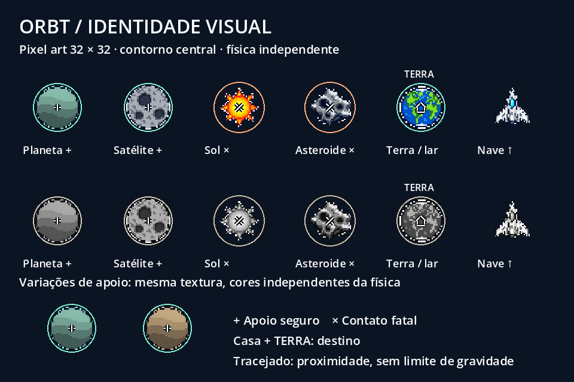

# Identidade visual mínima — #3 / #27–#31

Implementação integrada pelo PR #45 à `main` em `6db0abb`, preservada no PR #46. Estado conferido em 26/10/2026; revisão das imagens continua adiada. Recursos propostos para revisão em Godot 4.7.2, retrato. A linguagem segue o GDD: exploração espacial, tecnologia clara, fundos azul-escuros, pixel art de leitura rápida. Não altera raios, massa, gravidade, combustível, limites ou contato dos JSONs.

## Inventário e padrões

| Recurso | Arquivo/fonte | Grade, pivô e escala | Função e prioridade |
| --- | --- | --- | --- |
| Nave | `Recursos/Sprites/Identidade/nave.png`; fonte `fontes/nave.png` | 32×32 RGBA, centro; frente para cima; pixels do casco contidos no raio da nave | P1: casco claro, cockpit ciano, nariz pontudo e asas; substitui visual em execução |
| Planeta | `Identidade/planeta.png`; `fontes/planeta.png` | 32×32, centro; conteúdo cabe em `visual_radius` | P1: apoio circular com bandas e símbolo + |
| Satélite | `Identidade/satelite.png`; `fontes/satelite.png` | 32×32, centro; `visual_radius` | P1: apoio circular com crateras e +, distinto do planeta |
| Sol | `Identidade/sol.png`; `fontes/sol.png` | 32×32, centro; `visual_radius` | P1: coroa pontuda, × e anel da área fatal em `danger_radius` |
| Asteroide | `Identidade/asteroide.png`; `fontes/asteroide.png` | 32×32, centro; `visual_radius` | P1: silhueta angular, crateras, × e área fatal explícita |
| Terra | `Identidade/terra.png`; `fontes/terra.png` | 32×32, centro; `visual_radius` | P1: oceanos/continentes, casa e rótulo TERRA |
| Propulsão/RCS | `src/Visual/propulsao_pixel.gd`; partículas nativas | Seis quadros em código; pulso de 0,5 s, sem rastro persistente | Bitmaps legados retirados da cena e excluídos do pacote; revisão visual Android pendente. [Origem e evidências](propulsao/README.md) |
| Círculo de cancelamento | `src/Nave/mira_nave.gd` | Unidades lógicas de entrada, independente da câmera | P1: círculo com contorno escuro; × quando não há impulso válido |
| Trajetória | Mesmo script, cálculo de produção preservado | Linha fina clara com base escura; ponto final | P1: estimativa de até 3 s; não cobre a nave com efeitos |
| Colisão/perigo | `src/Visual/marcas_corpo.gd` | Anel contínuo no raio de colisão ou perigo | P1: indicação de superfície ou zona fatal; sprites não determinam contato |
| Captura | Marcas de depuração no mesmo script | `capture_radius`, independente do visual e da proximidade | Inspeção técnica opcional; ativar `marcas.depuracao` no inspetor remoto |
| Proximidade | Mesmo script, flag recebida da partida | Arco tracejado em `proximity_radius` | P1: aviso de entrada, não limite gravitacional; texto redundante no HUD |
| Combustível/tempo | `src/Visual/indicadores.gd` e HUD | Texto completo e barras proporcionais; 5 segmentos de combustível | P1: valores numéricos são referência exata, segmentos representam proporção quando capacidade difere de 5 |
| Pausa/reinício/exploração/recentralização/campanha | `src/Visual/tema_visual.gd` e botões existentes | Borda de 1 unidade, estados de foco/hover/pressionado/desabilitado; rótulos explícitos | P1: tema comum, sem texto gravado em bitmaps |
| Vitória/derrota | HUD existente com o novo tema | Texto da causa e reinício; altura do bloco ajustada ao conteúdo | P1: legibilidade; não adiciona explosão cobrindo corpos ou colisão |
| Fundo | `Nivel.tscn` e `gerador_estrelas.gd` | Estrelas discretas de 1 unidade, posições determinísticas | P1: cenário de menor contraste; brilho/bloom desativados |

`Identidade/` na tabela é relativo a `Recursos/Sprites/`. A grade 32×32 e a paleta são propostas desta entrega, ainda sem aprovação no aparelho. Usar nearest-neighbor, sem mipmaps, importação lossless. A escala visual considera o pixel opaco mais distante do pivô para manter todo o casco/objeto dentro do raio configurado. O raio físico é independente e continua vindo do JSON.

O contorno contínuo dos apoios marca a geometria sólida; a captura pode ocorrer fora dele conforme o JSON. A inspeção opcional mostra captura e raio visual separadamente. Perigos têm × sobreposto, mesmo se sua textura sugerir cavidades. Terra tem símbolo de casa e texto, portanto a função não depende apenas de azul/verde. A prancha inclui uma renderização em tons de cinza.

## Cores e variações

Fundo `#0b1423`, texto `#f4f8ff`, destaque seguro `#82f0d1`, aviso `#ffac78`. Planetas recebem uma de duas tintas propostas em `ArtePixel.APOIOS`: menta `#a8ead5` ou areia `#f4d1a0`, escolhidas de forma estável pelo ID. Trocar a tinta modifica somente `Sprite2D.modulate`; +, anel, posição e parâmetros permanecem independentes. Os dois exemplos estão na prancha. Satélite, perigos e Terra preservam suas cores-base e silhuetas.

Os prompts solicitaram uma paleta curta; os arquivos gerados não são tratados como uma paleta indexada fixa. As fontes são PNGs RGBA editáveis em editores de pixel art. Não há fonte Aseprite em camadas nesta entrega.

## Origem e reprodução

Os seis novos sprites foram gerados pela ferramenta integrada **OpenAI ImageGen**, nesta solicitação de 22/10/2026. A direção usa o GDD e a linguagem das referências locais; os arquivos preexistentes em `Recursos/ModelosVisuais/` foram preservados e não entraram no commit. Não foram usados downloads de bibliotecas externas na produção destes seis sprites.

Os prompts completos estão em [prompts.json](prompts.json): concatenar `base` com a entrada correspondente de `subjects`. [manifesto.json](manifesto.json) registra arquivos, origem, preparação e hashes SHA-256 das fontes e saídas. Não se atribui CC0/MIT nem uma licença pública adicional aos novos materiais; não há atribuição de arte de terceiros para eles. Os bitmaps legados de propulsão permanecem no histórico, com origem não esclarecida, mas foram substituídos na cena e excluídos do pacote; ver [registro da substituição](propulsao/README.md).

As fontes originais estão em `docs/auxiliar/arte/fontes/`, excluídas da importação e exportação; os seis arquivos de produção ficam em `Recursos/Sprites/Identidade/`. Para repetir a preparação, execute Godot com `--headless --path . --script scripts/preparar_sprites.gd`. O script somente recorta transparência, centraliza em um quadrado e reduz por nearest-neighbor para 32×32; preserva as fontes. Depois, importe o projeto no editor. Edições manuais nas fontes exigem regenerar saídas e atualizar os hashes do manifesto.

## Verificação

Godot 4.7.2 / Windows, 22/10/2026: 69 verificações de controles, 142 de partida, 32 do editor, 31 da campanha, 38 visuais e 22 do pacote exportado passaram: **334 no total**. A suíte visual confere transparência/grade, filtro/pivô, escala em relação ao raio, dados imutáveis, reinícios sem acúmulo, botões dentro da tela em jogo/pausa/vitória e a rota de referência com o mesmo consumo. A verificação do pacote confere os seis sprites incluídos e as fontes fora da entrega.

Capturas inspecionadas: `.godot/fase-inicial.png`, `fase-mira.png`, `fase-pausada.png`, `fase-vitoria.png`, `identidade-visual.png`, `identidade-alerta.png` e `identidade-derrota.png`. Reproduzir com `tests/capturar_fase.gd` e `tests/capturar_identidade.gd`, usando renderizador real. O segundo monta um Sol apenas em memória para capturar alerta/derrota; não modifica o JSON autoral. Os resultados desktop não aprovam grade, cores ou ergonomia no Android.

Aceite pendente: registrar APK/revisão, modelo/Android/Godot e capturas com mira, pouso, alerta e derrota no telefone; testar contraste e oclusão pelo polegar, margens e leitura em movimento; aprovar as variações e a apresentação do novo efeito de propulsão. As issues #3/#27–#31 não são encerradas por estas evidências desktop.
