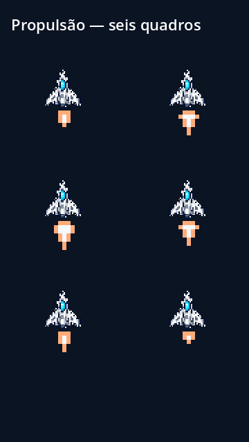
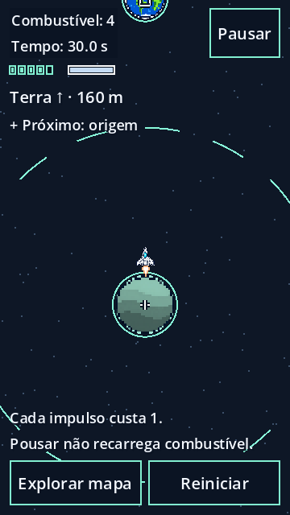

# Propulsão em código — issues #29 e #51

Entrega sobre `9f3187a`, em 30/10/2026. O efeito substitui os seis bitmaps legados `fogo1.png`–`fogo6.png`, cuja origem não foi esclarecida. Os arquivos antigos são preservados no repositório, sem referências na cena de produção, e excluídos pelo preset Android. A cena também passa a referenciar diretamente o casco `Identidade/nave.png`, já usado em execução; `nave1.png` sai das dependências e do pacote.

Os seis quadros são matrizes de pixels definidas em `src/Visual/propulsao_pixel.gd`, escritas para ORBT nesta entrega, sem imagens, amostras ou bibliotecas de arte externas. O desenho usa retângulos de uma unidade, núcleo `#f4f8ff` e borda `#ffac78`, da paleta existente. Os quadros têm largura de cinco unidades e altura de três a sete, posicionados abaixo do casco. O arquivo de código é a fonte editável; não existe bitmap gerado nem licença pública adicional declarada.

O `AnimationPlayer` existente controla os quadros durante o mesmo pulso de 0,5 s. Antes do lançamento e ao terminar, parar ou reiniciar, a animação seleciona o quadro vazio `-1`. O efeito herda posição, rotação e pausa da nave. RCS continua usando partículas nativas sem textura externa. Não foram alterados impulso, combustível, gravidade, colisões ou conteúdo das fases.

## Verificação

Resultado: `tests/run.ps1` aprovou 2.611 verificações, incluindo 56 visuais e 21 de menus. `tests/run_exportacao.ps1` exportou o PCK e aprovou 30 verificações no desktop. Nenhum ensaio Android foi realizado nesta entrega.

Godot 4.7.2/Windows: testes cobrem os seis quadros acionados pelo lançamento de produção, suspensão na pausa, apagamento ao terminar/reiniciar e créditos atualizados. A verificação do pacote comprova a ausência dos seis bitmaps legados e do casco antigo, além de executar a primeira fase e conferir consumo. A revisão visual foi feita com D3D12 real no desktop; legibilidade e apresentação em Android continuam pendentes. Esta substituição não determina a autoria dos arquivos antigos nem encerra as issues de arte ou menus.

Reproduzir capturas com `godot --path . --script tests/capturar_propulsao.gd`. As saídas ficam em `.godot/propulsao-quadros.png` e `.godot/propulsao-lancamento.png`. A prancha usa ampliação de três vezes para inspecionar a forma; a captura de lançamento mostra o enquadramento do jogo.

