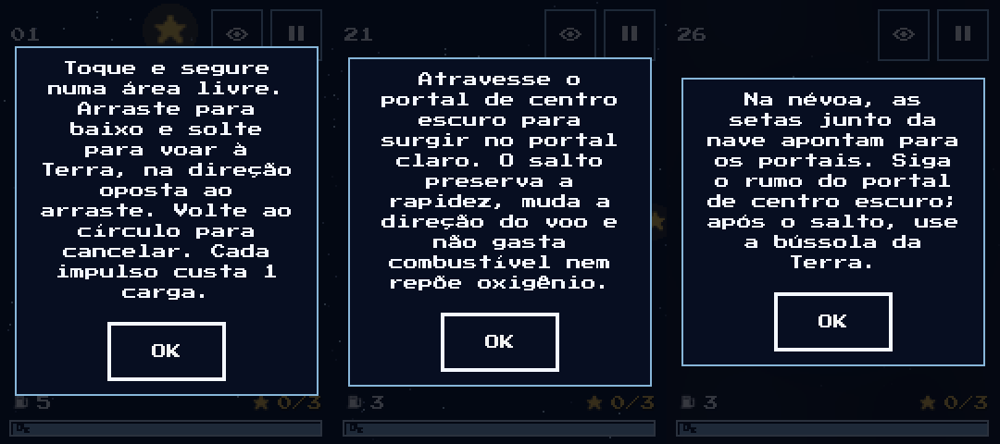

# Revisão do tutorial e das dicas — issue #54

Data: 11/11/2026. Base: `alpha`, commit `48adc8166573b6320d9c3d7c6a48590d9c1ebe21`. Branch: `melhorias/tutorial-campanha-54`.

A [issue #54](https://github.com/EclipseEstudio/ORBT/issues/54) trata da clareza do tutorial existente. Foram conferidas as 30 fases de `Recursos/Niveis.json`, suas dicas, os recursos presentes nos JSONs e a apresentação efetiva no jogo. As correções seguem a física, a interface e as rotas de teste atuais.

## Correções de conteúdo

| Fase | Correção |
| --- | --- |
| 1 — Primeiro impulso | Ensina tocar e segurar, arrastar na direção oposta ao voo, soltar, voltar ao círculo para cancelar e o custo de uma carga. |
| 2 — Mira aberta | Distingue douradas que contam para liberar níveis da azul opcional; informa que chegar à Terra confirma as coletas. |
| 3 — Passagem larga | Explica que o oxigênio é consumido em voo e deixa de ser consumido no pouso. |
| 4 — Primeiro pouso | Explicita que pousar não recarrega combustível e exige reservar carga para decolar. |
| 5 — Segundo impulso | Refere-se ao conjunto de rochas existente e explica correção em voo e tanque de uma carga. |
| 7 — Escala no desvio | Remove a ambiguidade sobre estrela opcional: a azul é opcional, enquanto douradas contam para os portões. |
| 9 — Curva gravitacional | Distingue a guia reta da trajetória que a gravidade pode curvar. |
| 11 — Estação em movimento | Identifica a estação orbital como apoio a interceptar e explica a velocidade herdada na saída. |
| 12 — Janela orbital | Explica que o movimento da estação é somado ao impulso de saída. |
| 13 — O Contorno | Refere-se às várias rochas existentes. |
| 15 — Pouso de precisão | Identifica os arcos verdes que delimitam pousos válidos e o risco de chegar fora deles. |
| 16 — Travessia orbital | Explica a interceptação e a velocidade herdada do apoio orbital. |
| 17 — Arco entre rochas | Remove a afirmação de gravidade durante todo o voo; esclarece a limitação da guia reta. |
| 19 — Cinturão em movimento | Refere-se às várias rochas em órbita. |
| 20 — Manobra combinada | Nome e dica indicam a síntese do segundo nível, sem anunciar o fim de uma campanha de 30 fases. |
| 21 — Fenda no Espaço | Usa centros escuro e claro, que são visíveis no jogo, em lugar de letras A/B e de uma seta desenhada no portal que não existe. Explica rapidez preservada, direção alterada e ausência de reposição de oxigênio. |
| 22 — Salto entre Rochas | Substitui letras A/B pela aparência dos portais. |
| 23 — Névoa Cega | Distingue cenário oculto dos instrumentos ainda visíveis, inclusive na exploração do mapa; remove referências a tanques e portais ausentes nessa fase. |
| 25 — Desvio Nebuloso | Orienta pela seta do tanque e pela reserva de combustível na rota de escalas, sem afirmar que nenhuma outra rota seria possível. |
| 26 — Portal Invisível | Refere-se às setas junto da nave e à bússola, sem prometer informação numérica de distância. |
| 27 — Giro na névoa | Nome e dica descrevem a rotação do planeta existente, sem sugerir uma órbita que a fase não possui. |
| 28 — Rede de Portais | Descreve a sequência dos dois pares sem depender das letras A–B/C–D ausentes da tela. |
| 30 — O Grande Retorno | Diferencia decolagens e correções em voo; a rota de referência usa seis impulsos, que não são seis decolagens. |

As dicas das fases **6, 8, 10, 14, 18, 24 e 29** foram conferidas e mantidas: descrevem recursos e comportamentos presentes. Os exemplos fora do catálogo não integram esta revisão.

Os IDs `ultima_manobra` e `orbita_cega` continuam iguais para preservar catálogo e progresso. A comparação estrutural das 30 fases com a base confirmou que todos os campos fora de `name` e `tutorial` permanecem iguais, inclusive versões de conteúdo, recursos, estrelas, posições e física.

## Apresentação

Na ajuda contextual de exploração, a mensagem de oxigênio agora distingue nave em voo de nave pousada. A visibilidade da ajuda contextual continua seguindo o comportamento existente.

A inspeção renderizada revelou que a bússola, com ordem de desenho própria, atravessava o texto do diálogo. O diálogo de dica agora é desenhado acima dela. A opção de desativar dicas, a pausa para leitura e a confirmação por OK foram preservadas.

## Validação técnica

Ambiente: Windows, Godot 4.7.2 estável. Total: **1.740 verificações, zero falhas**.

| Suíte | Verificações | Evidência |
| --- | ---: | --- |
| `test_tutorial.gd` | 257 | Controles, cancelamento sem gasto, custo, pouso, reinício, ordem do diálogo e oxigênio na exploração. Abre as 30 dicas em 180×240 e 180×320, conferindo texto completo, encaixe, botão de pelo menos 64×32 e retomada após OK. Execução com renderização OpenGL Compatibility. |
| `test_opcoes_jogador.gd` | 22 | Persistência das opções, desativação de dicas, reativação durante a tentativa e feedback tátil. |
| `test_fases.gd` | 1.209 | Rotas e coletas das fases 1–20. |
| `test_campanha_30.gd` | 252 | Catálogo, recursos, progressão e rotas das fases 21–30. |

A comparação estrutural dos 30 JSONs e `git diff --check` também passaram. A inspeção visual cobriu exemplos das instruções iniciais, portais e nebulosa em 180×240.

## Aceite ainda pendente

Os testes comprovam integração e comportamento; não comprovam compreensão por uma pessoa. Para encerrar a issue, ainda é necessário observar um jogador que não seja autor, sem ajuda verbal, e conferir legibilidade e toque no APK atual em Android. Registrar revisão, aparelho, passos e resultado conforme a [validação pendente](../../projeto/validacao-pendente.md).

Não foi gerada uma release nem alterado o status remoto da issue nesta revisão.
